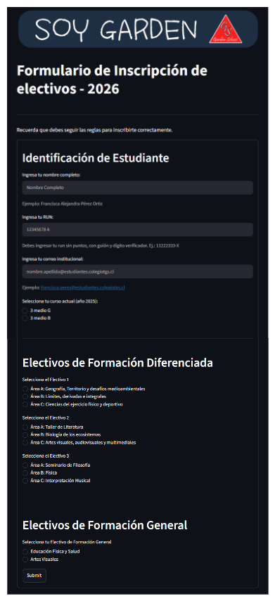
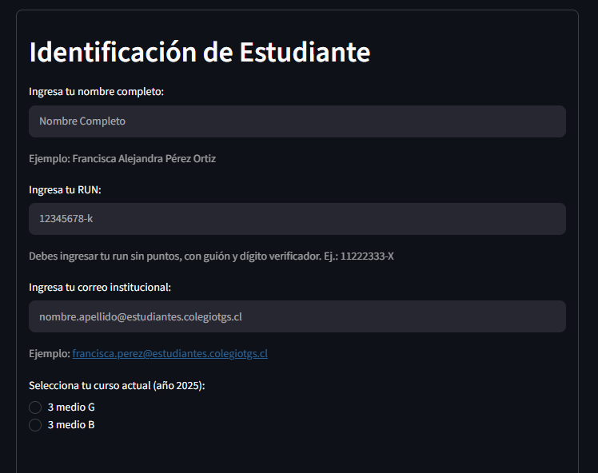
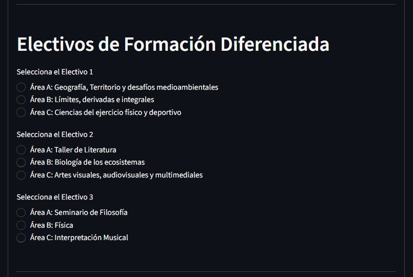
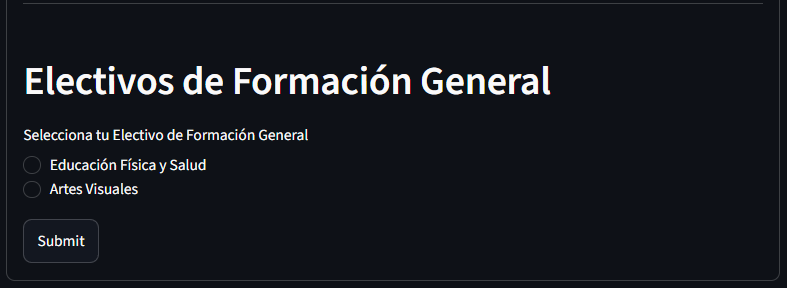
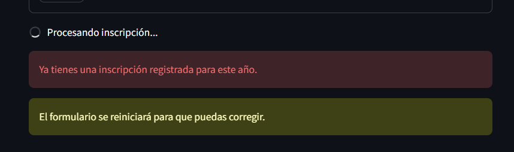
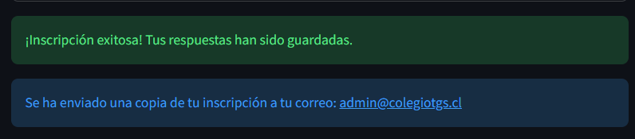
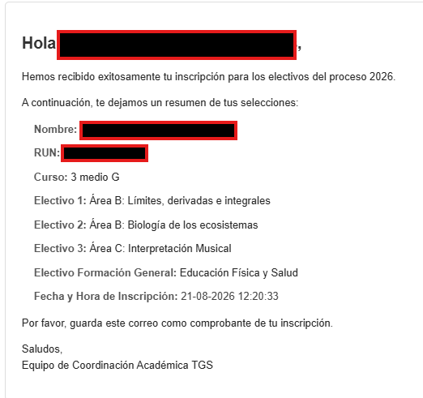

# Manual de Usuario: Formulario de Inscripción de Electivos
### Colegio Talagante Garden School

---

## 1. Introducción y Objetivo

Bienvenido/a al **Manual de Usuario del Formulario de Inscripción de Electivos**. Esta plataforma web ha sido desarrollada para que los y las estudiantes del **Colegio Talagante Garden School** puedan realizar su proceso de selección y postulación a las asignaturas de **Formación Diferenciada** y **Formación General** de manera rápida, transparente y segura.

El sistema cuenta con validación de datos en tiempo real, control automático de cupos por asignatura y envío instantáneo de un comprobante oficial de inscripción a tu correo institucional.

---

## 2. Requisitos Previos

Antes de comenzar a completar el formulario, asegúrate de contar con lo siguiente:

1. **Correo electrónico institucional activo:** Debe ser tu cuenta oficial terminada en `@estudiantes.colegiotgs.cl`.
2. **Cédula de Identidad (RUN):** Conocer tu RUN completo, incluyendo el dígito verificador (número del 0 al 9 o letra K).
3. **Decisión informada de electivos:** Haber revisado con anterioridad la oferta académica de asignaturas electivas correspondientes a tu nivel y sus reglas de combinación.
4. **Dispositivo con conexión a Internet:** Puedes acceder desde cualquier computador, tablet o teléfono móvil mediante un navegador web actualizado (Google Chrome, Mozilla Firefox, Safari, Microsoft Edge).

---

## 3. Guía Paso a Paso para la Inscripción

A continuación, se detalla cada una de las secciones que componen el formulario.



---

### Paso 1: Identificación del Estudiante

En este primer bloque debes ingresar tus antecedentes personales y académicos. Todos los campos son obligatorios:



1. **Ingresa tu nombre completo:**
   * Escribe tus nombres y apellidos tal como figuran en tu registro escolar.
   * *Ejemplo:* `Francisca Alejandra Pérez Ortiz`.
2. **Ingresa tu RUN:**
   * Ingrésalo **sin puntos, con guión y con dígito verificador**.
   * *Ejemplo:* `12345678-k` o `11222333-9`.
3. **Ingresa tu correo institucional:**
   * Escribe tu dirección de correo oficial del colegio. A esta dirección se enviará el comprobante de respaldo.
   * *Ejemplo:* `francisca.perez@estudiantes.colegiotgs.cl`.
4. **Selecciona tu curso actual:**
   * Marca la casilla correspondiente a tu curso actual (por ejemplo: `3 medio G` o `3 medio B`).

---

### Paso 2: Selección de Electivos de Formación Diferenciada y Reglas de Inscripción

En esta sección debes seleccionar tus tres asignaturas de formación diferenciada (un electivo en cada bloque). Cada asignatura pertenece a un área formativa del plan de estudios:
* **Área A:** Lengua y Literatura / Filosofía / Historia y Ciencias Sociales.
* **Área B:** Matemática / Ciencias (Biología, Física, Química).
* **Área C:** Artes / Educación Física y Salud.



#### 📋 Reglas Obligatorias de Inscripción:

> [!IMPORTANT]
> **1. Regla de Diversidad de Áreas (No 3 electivos de la misma área):**
> * No está permitido inscribir 3 electivos pertenecientes a la **misma área temática**.
> * Tus 3 elecciones deben pertenecer al menos a **2 áreas diferentes** (por ejemplo: 2 electivos del Área B y 1 electivo del Área A, o 1 del Área A, 1 del Área B y 1 del Área C).

> [!IMPORTANT]
> **2. Regla de No Repetición de Asignaturas (Continuidad 3° a 4° Medio):**
> * Si pasas a **4° Medio**, no puedes inscribir un electivo que ya hayas cursado durante **3° Medio**. El sistema validará automáticamente tu historial para evitar asignaturas repetidas.

> [!NOTE]
> **3. Regla de Cupos Disponibles por Asignatura:**
> * Cada electivo cuenta con un número limitado de cupos. Las vacantes se van completando en estricto orden de envío en la plataforma. Si un electivo agota sus cupos, el sistema te notificará para que escojas otra opción.

> [!NOTE]
> **4. Selección Única por Bloque:**
> * Debes seleccionar exactamente **1 asignatura** en el Electivo 1, **1 asignatura** en el Electivo 2 y **1 asignatura** en el Electivo 3.

---

### Paso 3: Selección de Electivo de Formación General y Envío

En el último bloque encontrarás la selección de tu electivo común de formación general:



1. **Selecciona tu Electivo de Formación General:**
   * Marca la asignatura de tu preferencia (por ejemplo: *Educación Física y Salud* o *Artes Visuales*).
2. **Presiona el botón `Submit`:**
   * Una vez completados todos los campos, haz clic en el botón **Submit**.
   * El botón se desactivará inmediatamente para evitar envíos duplicados mientras el sistema procesa tu solicitud.

---

## 4. Validaciones del Sistema y Mensajes de Alerta

El sistema realiza revisiones automáticas para garantizar la consistencia de la información:

### A. Campos obligatorios no completados
Si dejas algún campo en blanco o no seleccionas alguna opción, el sistema mostrará:
```text
Debes llenar todos los campos para continuar. El formulario se reiniciará en 2 segundos.
```

### B. Formato de RUN incorrecto
Si el RUN no cumple con el formato estándar con guión y dígito verificador, el sistema indicará:
```text
El RUN ingresado no tiene un formato válido.
```

### C. Inscripción previa, incompatibilidad de áreas o cupos agotados
Si ya te encuentras inscrito/a en el proceso actual, si seleccionaste 3 electivos de la misma área, si repetiste un electivo del año anterior, o si una asignatura agotó sus cupos, la plataforma desplegará la advertencia correspondiente y reiniciará el formulario para que puedas corregir tu selección:



---

## 5. Confirmación y Comprobante Oficial

### Confirmación en Pantalla
Cuando tu inscripción sea aceptada e ingresada exitosamente en la base de datos, la plataforma mostrará un mensaje de éxito en color verde y la confirmación del envío del correo electrónico:



---

### Comprobante por Correo Electrónico
Inmediatamente después de la inscripción, recibirás un correo electrónico oficial con el detalle completo de tus asignaturas registradas y la fecha/hora exacta de la transacción:



> [!IMPORTANT]
> **Conserva este correo:** Este mensaje sirve como comprobante oficial de tu postulación y horario de registro.

---

## 6. Preguntas Frecuentes (FAQ)

### 1. ¿Puedo cambiar mis electivos después de enviar el formulario?
No a través de la plataforma web. Una vez que tu postulación queda registrada exitosamente, el sistema bloquea nuevas inscripciones para el mismo RUN con el fin de resguardar el orden de prelación y los cupos disponibles. Si necesitas solicitar una rectificación, deberás comunicarte con la Unidad de Informática / Coordinación Académica.

### 2. ¿Por qué no me deja seleccionar 3 electivos de Ciencias / Humanidades?
Porque la normativa del plan diferenciado exige cursar asignaturas de al menos 2 áreas distintas. No está permitido elegir los 3 electivos dentro de una misma área (Área A, B o C).

### 3. ¿Por qué el botón "Submit" queda deshabilitado?
Es una medida de seguridad para evitar que se envíen solicitudes dobles al hacer clic reiterado. Si hubo un error en los datos, el formulario se reiniciará automáticamente tras unos segundos para permitirte corregir.

---

## 7. Problemas Frecuentes y Soluciones

A continuación se detallan los principales incidentes técnicos y cómo resolverlos:

| Problema / Mensaje | Causa Común | Solución Paso a Paso |
|:---|:---|:---|
| **«El RUN ingresado no tiene un formato válido»** | El RUN fue escrito con puntos o sin guión/dígito verificador. | Ingrésalo sin puntos, con guión y dígito verificador. Ejemplos válidos: `12345678-k` o `11222333-9`. |
| **«El formulario se reinicia solo tras presionar Submit»** | Quedó algún campo vacío o no marcaste opción en alguno de los 4 bloques electivos. | Completa todos los datos personales y asegúrate de marcar un electivo en cada bloque antes de presionar Submit. |
| **«Ya tienes una inscripción registrada para este año»** | Tu RUN ya completó exitosamente el proceso de postulación. | Revisa tu correo institucional `@estudiantes.colegiotgs.cl` para encontrar el comprobante enviado. |
| **«No me llegó el correo de confirmación»** | El correo fue derivado a la bandeja de correo no deseado o filtro antispam. | 1. Revisa tu carpeta de **Spam** o **No deseados**.<br>2. Si la pantalla mostró la alerta verde de éxito, tus datos están guardados en la base de datos.<br>3. Toma una captura de pantalla como respaldo adicional. |
| **«Error de conexión con la base de datos»** | Inestabilidad temporal de la conexión a Internet o del servidor. | Espera 10 a 15 segundos y recarga la página en tu navegador para volver a intentar el envío. |

---

## 8. Contacto y Soporte

Si presentas inconvenientes técnicos con la plataforma o tu correo institucional, puedes contactar a la **Unidad de Informática**:

* **Unidad de Informática:** Colegio Talagante Garden School
* **Correos de contacto:**
  * `admin@colegiotgs.cl`
  * `ba.calderon@colegiotgs.cl`
